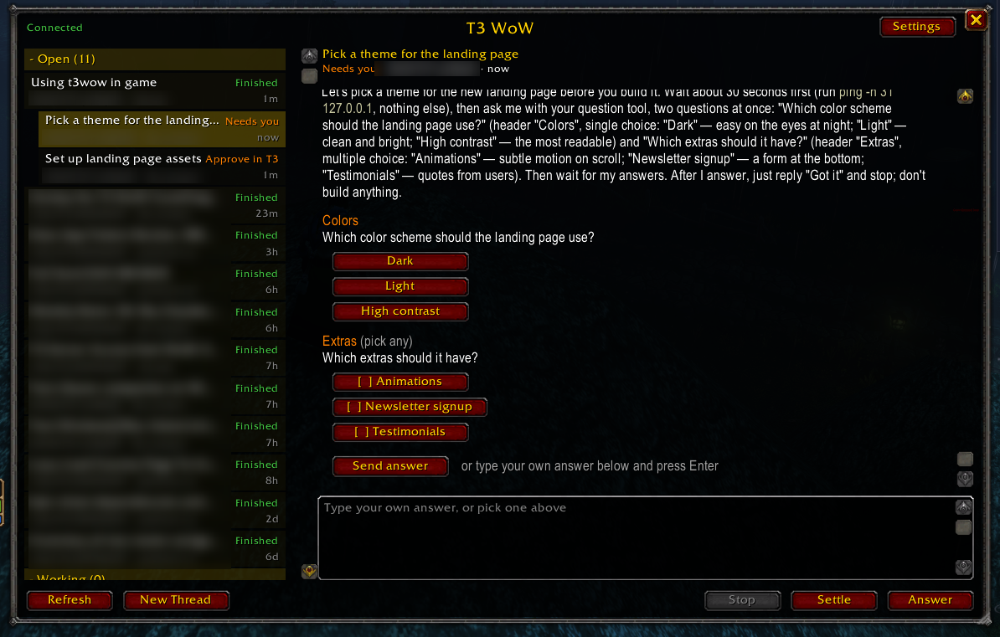

<p align="center"></p>

# T3 WoW

T3 Code inside World of Warcraft: Forever. You bring your harnesses to T3 Code; this brings T3 Code into WoW.

An in-game window lists your T3 threads from every machine your T3 Code reaches (this PC and its linked environments), shows a thread's conversation, and lets you message it, answer an agent's questions, start a new thread, stop a run, and settle or unsettle a thread. When a thread finishes, fails or needs you, a notification slides in.

<p align="center"></p>

More screenshots are in [`assets/screenshots`](assets/screenshots).

## What you need

- Windows, with WoW: Forever in **windowed** or **borderless windowed** mode (exclusive fullscreen blocks screen capture).
- T3 Code desktop running on the same PC, or on another machine this PC can reach over the network: run `t3wow.exe login --origin http://<host>:<port>` once to point the companion at it (over a LAN, prefer Tailscale or HTTPS, since plain HTTP sends the sign-in token unencrypted). Threads on other machines also show up when they are linked to T3 under **Settings → Environments → Linked environments**.

## Set up

1. Get `t3wow.exe` (built with `npm run build:exe`, see Develop) and double-click it. It's a small native program (about 4 MB, nothing else to install) that lives in the system tray, next to the clock. Windows may warn about an unrecognized app the first time, since it isn't signed: **More info → Run anyway**.
2. It finds WoW: Forever (a running client, Battle.net's install record, or the usual folders; if it can't, its tray menu has **Choose WoW folder…**), puts the addon and its update slots into `Interface\AddOns`, and opens T3's sign-in page.
3. Approve the sign-in. If it asks for a pairing code, make one in T3 under **Settings → Sharing & access**. Choose **Full access** if your threads run in full access; T3 refuses messages to a thread that runs above the access you grant. The sign-in lasts 30 days; after that the game window and the tray menu say so: choose **Sign in to T3…** in the tray menu.
4. **Restart WoW completely** (not `/reload`) the first time: the game only sees addon files that existed when it started. In the AddOns list keep **T3 WoW** and the grey **T3 WoW slot** entries enabled.
5. Leave T3 WoW running in the tray while you play. Its menu shows the T3 and WoW status, and has **Sign out of T3** (or **Sign in to T3…**), **Start with Windows**, **Reinstall addon**, **Open log** and the update check.

Every start checks the addon files: anything an addon manager or a cleanup removed is put back, and a newer addon shipped with the companion replaces an older one. If it had to create files, restart WoW once more.

**Updates.** The companion looks for a newer GitHub release when it starts and every 6 hours; the tray menu then offers **Update to x.y.z**, which downloads the new `t3wow.exe`, checks it against the release's SHA-256, swaps it in and restarts. The addon is part of the exe, so it updates along with it (restart WoW afterwards). An addon installed from CurseForge updates there; the companion never replaces a newer addon with an older one. `t3wow.exe update` does the same from a terminal. Releases are published to the public [t3wow-releases](https://github.com/MatiasCiccone/t3wow-releases) repository while this one stays private.

`t3wow.exe` also works from a terminal: `run` runs in that console instead of the tray, `install` reinstalls the addon from scratch (`--wow "<path to _forever_>"` if WoW lives somewhere unusual), `login` signs in again (`--origin <url>` points it at a T3 on another machine, `--origin local` goes back to the T3 on this PC once it's running; a running companion picks up the new T3 and sign-in within 30 seconds), `status` checks the addon install and the T3 connection, and `uninstall` removes the addon.

## In the game

Each login and reload says in chat that T3 WoW loaded, then that it connected to T3 once the companion's first update arrives (and how many threads need you).

`/t3`, the **T3 WoW** minimap button, or a key bound under **Options → Keybindings → AddOns → T3 WoW** opens the window. The button registers through LibDBIcon when another addon has loaded it, so collectors like MinimapButtonButton gather it with your other buttons. Right-click it (or `/t3 settings`, or **Settings** in the window) for the settings.

- Pick a thread on the left; **Open**, **Working**, **Snoozed** and **Settled** match T3's sidebar. The machine name is under each title. Threads an agent started sit indented under the thread that started them, as in T3. A thread whose agent is asking you something shows **Needs you**.
- Type in the box and press **Enter** (Shift+Enter for a new line). Sending to a busy thread steers it or queues, as in T3.
- **New Thread** asks for the machine and project, then starts a thread with your message as its task.
- **Stop** interrupts a running thread. **Settle** / **Unsettle** moves it between Open and Settled.
- When a thread you are not looking at finishes, needs you or fails, a notification slides in near the top of the screen; click it to open the thread, right-click to dismiss. A line in chat and a sound come with it.
- **Settings** turns the notification, chat line and sound on or off, sets how long notifications stay (or until clicked) and how many stay on screen at once (the oldest makes room; a newer one for the same thread replaces it), moves them (**Move notifications**, then drag), picks which outcomes notify (stopped threads are off by default), and shows or hides the minimap button.
- `/t3 status` prints the link state; `/t3 probe` tests which file checks work on your client.

When an agent asks you a question, it shows at the end of the thread's conversation: pick an option (several, where it allows that) and press **Send answer**, or type your own answer in the box and press Enter. Permission prompts (approving a command or an edit) can't be answered through T3's tools by design: such a thread shows **Approve in T3**, and its thread view has an **Open in T3** button (the companion opens T3's own `t3code://` link). **Stop** cancels the run from the game. Clicking an approval's notification opens the thread in the game; turn on **Clicking an approval opens T3** in Settings to go straight to T3 instead.

## How it connects

WoW addons cannot open sockets or read files while running. The companion (`companion/`, Rust) bridges that from outside the game, without touching the game process:

- **Game → companion:** the addon draws each command as a strip of colored 4×4-pixel squares in the screen's top-left corner, only while a command is waiting. The companion screen-captures that corner of the WoW window four times a second and decodes it.
- **Companion → game:** an addon marked load-on-demand reads its file from disk when it is loaded, and each loads once per UI session. The companion creates 200 such slot addons. The companion writes the latest state into the next slot, then turns a pre-made blank font file into a real one (a copy of a Windows font, Lucida Console by default); the addon sees that font load and loads the slot. The game stops noticing a font file it has checked for too long, so while waiting the addon moves to the next signal file every 25 seconds; the companion shares the PC clock, works out the same file, and makes it and its neighbours real. No `/reload` per message. Until its first update tells it which font to watch, or if fonts don’t work on a client, the addon loads slots on a timer instead, which is slower and uses up the 200 updates sooner. `/t3 status` says which mode it is in, and `/t3 probe` tests the file checks.
- **Companion → T3:** T3's MCP endpoint on this PC (`/mcp`, signed in with OAuth). Threads on linked machines go through T3's own environment links.

Every UI session has 200 updates; the window offers **Reload UI** when they run out. The companion only spends one when something you can see changed.

The addon uses only the documented addon API. The companion reads pixels in one corner of the WoW window and writes files in the AddOns folder; it never sends input to the game or reads its memory.

## Troubleshooting

- **"Waiting for the companion…"**: is T3 WoW running in the tray? Is the game windowed? Is something covering the top-left corner? The tray's **Open log** shows what the companion sees.
- **"Slot addons blocked"**: enable the T3 WoW slot addons in the AddOns list, or allow out-of-date addons if the game's interface version changed (`t3wow.exe install --interface <number>` rewrites it).
- `/t3 status` prints the transport state in chat.

## Develop

Needs Node.js 20+ (for the addon's tests) and Rust with the MSVC toolchain (for the companion).

```sh
npm install
npm test            # the addon's Lua (in fengari) and the companion (cargo test)
npm run build:exe   # dist/t3wow.exe, Windows only
```

- `addon/T3WoW`: the addon (Lua). `tests/` runs it in a Lua VM: the font-signal logic against a simulated game, and the contract with the companion.
- `companion/`: the companion (Rust): screen capture (`capture.rs`), the T3 client and sign-in (`t3.rs`), the bridge (`bridge.rs`), the addon files (`slots.rs`, with the addon embedded) and the tray (`tray.rs`). `companion/tests/fixtures` holds the frames and inbox files both sides are tested against.
- `assets/`: the logo (`logo.png`, and `curseforge-avatar.png` at 400×400).

`build:exe` runs `cargo build --release` and copies the result to `dist/t3wow.exe` (`T3WOW_DIST` picks another folder). It signs the exe when a code-signing certificate is configured, using `signtool.exe` from the Windows SDK and a DigiCert timestamp. Set one of:

- `T3WOW_SIGN_THUMBPRINT`: a certificate in your Windows certificate store, including one on a hardware token.
- `T3WOW_SIGN_PFX` (and `T3WOW_SIGN_PASSWORD`): a `.pfx` file.
- `T3WOW_SIGN_DLIB` and `T3WOW_SIGN_METADATA`: Azure Trusted Signing's dlib and its `metadata.json`.

Without one it builds unsigned, and Windows SmartScreen warns on first run.

**CI** (`.github/workflows/ci.yml`) runs the tests, clippy and a release build on Windows for every pull request and every push to `main`, and attaches the built `t3wow.exe` to the run.

**Repository rules:** pull requests merge by rebase only (linear history), branches are deleted after merging, and Dependabot opens security fixes and weekly updates. `.github/rulesets/main.json` protects `main`: no force pushes or deletion, linear history, changes only through pull requests that pass CI (`test`) and get the code owner's review (`.github/CODEOWNERS`); repository admins can bypass. GitHub enforces rulesets on public repositories, or on private ones with GitHub Pro; apply it with `gh api repos/MatiasCiccone/t3wow/rulesets --input .github/rulesets/main.json`.

**Releasing:** set the same version in `companion/Cargo.toml`, `addon/T3WoW/T3WoW.toc` and `package.json`, then push a tag (`git tag v0.4.0 && git push origin v0.4.0`). The Release workflow checks the versions match, runs the tests, builds on Windows, and publishes `t3wow.exe`, `t3wow.exe.sha256` (what the updater downloads) and `T3WoW-v0.4.0.zip` (the addon alone, for CurseForge) to the public `MatiasCiccone/t3wow-releases`, with the commit subjects since the previous tag as notes. It needs the `RELEASES_TOKEN` secret: a fine-grained token with Contents read and write on `t3wow-releases` only. The same zip is uploaded to the [CurseForge project](https://www.curseforge.com/wow/addons) (ID 1788778) with the `CURSEFORGE_TOKEN` secret, filed under the WoW Forever version whose API version is the `.toc`'s `## Interface`; without the secret that step is skipped.

## License

MIT, see [LICENSE](LICENSE). The addon carries a copy in its folder.
