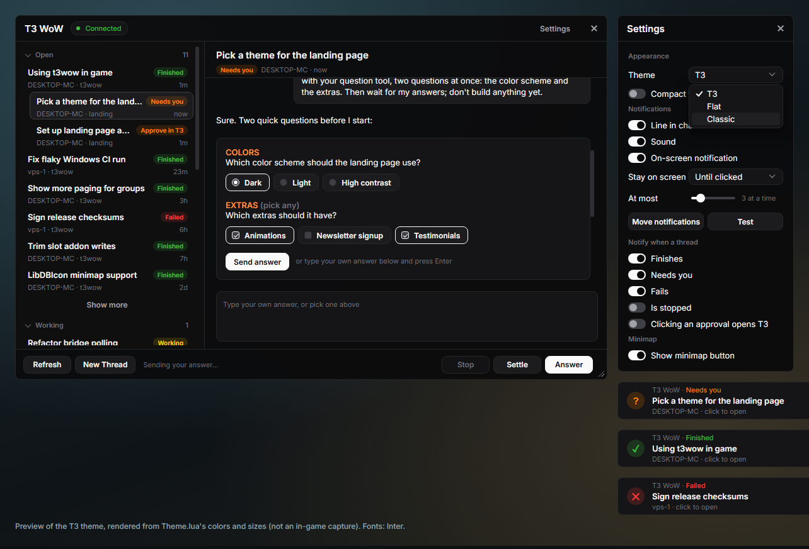

<p align="center"></p>

# T3 WoW

T3 Code inside World of Warcraft: Forever. You bring your harnesses to T3 Code; this brings T3 Code into WoW.

An in-game window lists your T3 threads from every machine your T3 Code reaches (this PC and its linked environments), shows a thread's conversation, and lets you message it, answer an agent's questions, start a new thread, stop a run, and settle or unsettle a thread. When a thread finishes, fails or needs you, a notification slides in.

<p align="center"></p>

The Flat and Classic themes and the compact thread list are in [`assets/screenshots`](assets/screenshots). These images are drawn from the addon's own `Theme.lua` and `UI.lua` by `npm run screenshots`, with made-up threads, not captured in the game.

## What you need

- Windows, with WoW: Forever in **windowed** or **borderless windowed** mode (exclusive fullscreen blocks screen capture).
- T3 Code desktop running on the same PC, or on another machine this PC can reach over the network (see [T3 on another machine](#t3-on-another-machine)). Threads on other machines also show up when they are linked to T3 under **Settings → Environments → Linked environments**.

## Set up

1. Get `t3wow.exe` (built with `npm run build:exe`, see Develop) and double-click it. It's a small native program (about 4 MB, nothing else to install) that lives in the system tray, next to the clock. Windows may warn about an unrecognized app the first time, since it isn't signed: **More info → Run anyway**.
2. It finds WoW: Forever (a running client, Battle.net's install record, or the usual folders; if it can't, its tray menu has **Choose WoW folder…**), puts the addon and its update slots into `Interface\AddOns`, and opens T3's sign-in page. The page opens by itself once per start; after that, **Sign in to T3…** in the tray menu opens it again, and choosing it while a sign-in is waiting starts that sign-in over.
3. Approve the sign-in. If it asks for a pairing code, make one in T3 under **Settings → Sharing & access**. Choose **Full access** if your threads run in full access; T3 refuses messages to a thread that runs above the access you grant. Read [Trust](#trust) before you do: the access you grant here is what commands from the game get. The sign-in lasts 30 days; after that the game window and the tray menu say so: choose **Sign in to T3…** in the tray menu.
4. **Restart WoW completely** (not `/reload`) the first time: the game only sees addon files that existed when it started. In the AddOns list keep **T3 WoW** and the grey **T3 WoW slot** entries enabled.
5. Leave T3 WoW running in the tray while you play. Its menu shows the T3 and WoW status (the WoW line also counts the updates used this UI session), and has **Sign out of T3** (or **Sign in to T3…**), **T3 server** (which T3 it uses, see [T3 on another machine](#t3-on-another-machine)), **Choose WoW folder…**, **Repair addon files** (puts back only what's missing), **Put back missing addon files automatically** (on by default), **Reinstall addon**, **Match WoW's interface version…**, **Commands from the game** (see [Trust](#trust)), **Open log**, **Start with Windows**, the update check and **Update checks** (see **Updates** below).

**What the tray tells you.** Everything the companion does happens in the background, so each action says how it went. A notification pops up from the tray when an action starts, when it's done and when it fails (with the reason): signing in or out, switching T3, checking for and installing updates, reinstalling the addon, changing **Commands from the game** or **Start with Windows**. While something takes a while (a download, a sign-in waiting for your browser), a line at the top of the menu and the tray icon's tooltip say what it's doing, like "Downloading update 0.6.0… 42%". After an update or a new WoW folder the companion restarts, and the new one confirms what changed. Notifications come and go with Windows' own settings: Do Not Disturb or Focus Assist "while playing a game" can hold them back, but the menu and tooltip always show the current state, and every notification is also written to the log (**Open log**).

**Restart WoW after the addon changes.** WoW reads addon files only when it starts; `/reload` doesn't pick up new ones. When an update, a reinstall or a repair changes the addon files while WoW is running, the tray says so: a notification as soon as it sees WoW running with the old files, and the WoW line in the menu (and the tooltip) starts with "restart WoW to load the new addon files (not /reload)" until that WoW quits. The game window says it too, where tray notifications can't reach you: the companion tells the addon which version is on disk, and when that's newer than the one the game loaded, the window's top line reads "T3 WoW 0.6.0 is installed: restart WoW to load it (/reload isn't enough)" and chat says so once per UI session. That also catches an addon manager updating the addon while you play. If WoW wasn't running, there's nothing to do: it loads the new files when it starts.

Every start checks the addon files: any of them an addon manager or a cleanup removed is put back, and a newer addon shipped with the companion replaces an older one. A newer addon (from CurseForge, say) is left alone and never patched with the companion's older files. If it had to create files, restart WoW once more.

Keep the addon and the companion at the same version. A newer addon with an older companion (a CurseForge update before the companion's), or the reverse until WoW restarts, still reads threads, sends messages and opens a thread it started. What needs both updated: a refused message or answer coming back to the box with its reason, a refused **Stop** saying why, recovery after WoW crashes, switching to timed updates when a long game session runs out of signal files, the game window saying to restart WoW after the addon changed, pictures, pasting images, New Thread's workspace choice (an older companion starts every thread in the current checkout), and the model, effort and permissions row in the box (with an older companion it stays hidden, as that companion would ignore the picks), and a thread's age from its last message or run (an older companion's count from the thread's last change of any kind).

Sign-ins are kept per T3: switching between the T3 on this PC and one on another machine doesn't sign you out of either. When the companion moves to another T3, or you choose **Sign out of T3**, the game drops everything it had from the previous one: its machines, threads, projects, the open thread, notifications, and commands from the game that hadn't gone out yet. One sent while the window still showed the previous T3 is refused rather than run on the new one, and comes back to the box with the reason; what you typed stays. This also holds for a switch made while WoW or the companion was closed, once the companion runs. Sign-ins are saved in `%APPDATA%\t3wow\config.json`, encrypted for your Windows user, so copying that folder to another PC or Windows user means signing in again. A sign-in only ever goes to the T3 that issued it.

### T3 on another machine

T3 Code can run on another PC on your network while you play here. In the tray menu, **T3 server** shows which T3 the companion uses (**this PC**, or the other machine's address) and switches between them:

- **Connect to T3 on another machine…** asks for its address: `host:port` like `192.168.1.20:3773` or `gaming-pc.lan:3773` (plain HTTP), or a full `http://` or `https://` URL. It checks the address before closing (a missing port, a typo), then checks that T3 answers there, and opens T3's sign-in page in your browser. Approve it as in [Set up](#set-up).
- **This PC** goes back to the T3 running here, and the other machine's address stays in the menu to switch back in one click.

The companion switches only once the sign-in succeeds; a failed, unreachable or cancelled one leaves it on the T3 it had, and the notification says why. Sign-ins are kept per T3, so switching back to a T3 whose saved sign-in still works needs no browser. The menu's top line shows the switch while it runs.

On that machine, T3 must accept connections from other machines on your network, and its firewall must let the port through; otherwise the companion reports that it couldn't reach T3 there.

Plain `http://` over your LAN works, but it sends the sign-in token across the network unencrypted, which the address box and the switch's notification both say. That's fine on a home network you trust. Anywhere else, use HTTPS (or a private network such as Tailscale). In a terminal, `t3wow.exe login --origin http://<host>:<port>` does the same switch.

**Updates.** By default the companion looks for a newer GitHub release when it starts and every 6 hours. The tray's **Update checks** submenu changes that: **When T3 WoW starts** turns the check at start on or off, the interval runs from **Every hour** to **Every week** or **Never**, and **Only when I check (no automatic checks)** turns every automatic check off, so the companion contacts GitHub only when you choose **Check for updates** (choose it again for the defaults). The interval counts from the last check, whether timed or chosen from the menu, across restarts too, and a change applies within a minute without a restart. When there is a new release, a notification pops up from the tray and the menu offers **Update to x.y.z**, which downloads the new `t3wow.exe` and installs it only if the download matches the release's SHA-256 file. Release signing is being set up: once a companion has the project's release key built in, it also requires that SHA-256 file to carry a valid signature made with that key, and refuses a release that is unsigned, signed with another key or altered. Companions released before that check the SHA-256 only. It then swaps the exe in and restarts. While it works, the menu's top line and the tooltip show the download's progress, then the check and the install; a failed update says why in a notification, and the menu offers it again. The restarted companion confirms the new version. The addon is part of the exe, so it updates along with it: if WoW is running, quit it and start it again (not `/reload`), which the tray reminds you of (see above). An addon installed from CurseForge updates there; the companion never replaces a newer addon with an older one. Releases are published to the public [t3wow-releases](https://github.com/MatiasCiccone/t3wow-releases) repository while this one stays private.

`t3wow.exe` also works from a terminal:

- `run` runs in that console instead of the tray.
- `install` reinstalls the addon from scratch (`--wow "<path to _forever_>"` if WoW lives somewhere unusual, `--interface <number>` to set the interface version).
- `login` signs in again. `--origin <url>` points the companion at a T3 on another machine, and `--origin local` goes back to the T3 on this PC once it's running, as the tray's **T3 server** menu does (but always through the browser). The new T3 is saved only once its sign-in succeeds: a failed or cancelled sign-in leaves the companion on the T3 it had. A running companion picks up the new T3 and sign-in within 30 seconds, and the game window then shows only the new T3's threads.
- `status` checks the addon install and the T3 connection. `status --origin <url>` (or `local`) checks that T3 with its own saved sign-in, without switching to it. Other commands don't take `--origin`.
- `update` downloads and installs the newest release, with the same checks as the tray. It doesn't restart a companion running in the tray: quit it from its menu and start it again. Only one update runs at a time; a second one stops with "another update is already running".
- `uninstall` removes the addon.

## In the game

Each login and reload says in chat that T3 WoW loaded, then that it connected to T3 once the companion's first update arrives (and how many threads need you).

`/t3`, the **T3 WoW** minimap button, or a key bound under **Options → Keybindings → AddOns → T3 WoW** opens the window. The button registers through LibDBIcon when another addon has loaded it, so collectors like MinimapButtonButton gather it with your other buttons. Right-click it (or `/t3 settings`, or **Settings** in the window) for the settings.

- Pick a thread on the left; **Open**, **Working**, **Snoozed** and **Settled** match T3's sidebar: Open runs down from the top, and the other three sit at the bottom and grow upward as you open them. They start with up to 80 open, 25 snoozed and 25 settled threads per machine at first. A group with more ends in **Show more**, which lists more of it (twice as many each time, up to 320 open, 200 snoozed and 200 settled) until a new UI session (Reload UI or login). The machine name is under each title. Threads an agent started sit indented under the thread that started them, as in T3. A thread whose agent is asking you something shows **Needs you**. The open thread's header, over its conversation, shows its status, machine, age and the branch its checkout is on (a long branch is cut short with "…"). The list doesn't show branches: T3 gives a thread's branch only when the thread itself is read, which the companion does for the open thread alone.
- **Search**, over the list, narrows it as you type to the threads whose title, project or machine has every word you type (case doesn't matter). While it has text, every group opens on its matches and a group with none hides. **Enter** opens the first thread it shows; **Escape** clears it. It searches the threads already listed: **Show more** under a group lists more of it to search. The magnifying glass shows once WoW has restarted after the update; until then the box works without it.
- The mouse's side buttons go **back** and **forward** through the threads you've opened since the UI loaded, as in T3, while the pointer is on the window. Quick presses add up, and only the thread they end on is opened.
- Type in the box and press **Enter** (Shift+Enter for a new line). The box keeps the keyboard so you can type the next message; **Escape** gives it back to the game. Sending to a busy thread steers it or queues, as in T3. If T3 refuses a message, it comes back to the box (when the box is empty) with the reason. A message too long to send from the game stays in the box.
- The message box is laid out as in T3. Inside it, on the right, sit the **model**, its **effort** and **Send**. In **New Thread**, the **machine** and the **permissions** sit under the box; the model, effort and permissions are yours to pick, and whatever you leave alone stays T3's default (the permissions chip shows what that is on the picked machine). Picking another machine starts over with its models. In an open thread, picking a model or an effort changes it right away, on any provider the machine runs; changing only the effort keeps the thread's other options (fast mode, say). When a thread moves to another provider, a line over the new provider's first message says so, as in T3 (**Context handoff · Claude Opus 5.5 > gpt-6.1-sol**). T3's tools list a machine's usual models from its enabled providers, not every model T3's own picker can reach. Once a thread has started, its machine goes and its permissions move into the model's menu. They can't change from the game, because T3's tools keep them once a thread exists: the menu's permissions row shows them and offers **Open in T3**. T3 refuses a mode above the access your sign-in grants. The permissions popover's icons show once WoW has restarted after the update; until then its buttons have words.
- Code blocks, inline code and tables show in a monospace font (JetBrains Mono, which ships with the addon), code blocks and tables on a box of their own. A table's columns line up; when the window is too narrow for one, its widest columns are cut short with "…" (clicking the message still copies all of it).
- Pictures: a page an agent showed with T3's html_render (a chart, a mockup) shows in the conversation as a picture, where T3 shows it, and so does an image a message embeds from a file on this PC (``: PNG, JPEG, GIF, BMP or WebP). The companion draws pages with Microsoft Edge (or Chrome) on T3's dark theme, at the width T3 draws them, so they look as they do in T3, but you can't click into them or scroll them. A picture shows pixel for pixel when the window is wide enough, and scaled down to fit when it isn't. Click it to enlarge it; click again or press Escape to close. Until a picture is drawn, a line says so. Each WoW session has 120 picture slots: a picture keeps its slot until WoW quits, and a thread opened again shows the pictures it already had. Past 120, a line says to restart WoW for more. Images from web addresses don't show. A page the agent passed as a file (T3 Code 0.18's `path`) is drawn from the copy T3 saved when it showed it (or from the file, if that copy is gone), so it looks as it did then even after the file changes or goes. T3 saves that copy on the machine the thread runs on, so such a page shows only for a thread on this PC with the T3 on this PC; anywhere else, a line says the page is a file on another machine.
- What the agent did between its messages (thinking, tool calls, questions you answered) shows as dimmed rows, collapsed as in T3. Click one to fetch and open it. A row appears once that stretch of work is finished. A finished turn folds under **Worked for** as in T3, leaving its last message and any question you answered in view.
- Start a word with **/** for the provider's commands and skills, **$** for its skills, or **@** for your other machines and the thread's machine's models. In the middle of a message a skill is written as **$name**, which T3 runs from anywhere. The list narrows as you type: the arrow keys move through it, **Tab** or **Enter** picks, **Escape** closes it. Commands and skills are listed only for the T3 running on this PC, and machines only from a thread on T3's own machine. **/clear** is T3's, as in T3 Code 0.18.0 and later: it starts a fresh session in the open thread. Pick it, or send it on its own, and a notice above the box says your next message starts fresh; its **×** keeps the current session. That message can't carry pasted images.
- **@** plus part of a model's or provider's name (**@opus**, **@gpt**, **@claude:haiku**) lists matching models after the machines, as in T3 Code 0.18. Each word you type has to start a word of the name, from two letters on, and the best matches come first, as in T3. Picking one writes T3's reference into the box, for example `model:claudeAgent/claude-opus-5-5`, and the box keeps it as that text. It names the model for the agent, to delegate to it, say. It doesn't switch the thread's model. In the conversation, a reference to a model the thread's machine has reads as the model's name, as T3's chip does; any other reference stays as written. Clicking the message to copy it gives you the reference, not the name. The models are the ones the model menu lists: T3's tools list a machine's usual models from its enabled providers, so a model only T3's own picker reaches stays text in the game.
- To send an image, copy it (a screenshot from **Win+Shift+S** or Snipping Tool, an image copied in a browser or an editor) and press **Ctrl+V** in the message box, in a thread or in **New Thread**. The game can't read the clipboard, so the companion reads the image and shows it small above the box; hover it for its size, click it to enlarge it, and its **×** takes it back. Once sent, it shows small under your message in the game; click it to enlarge it. T3 doesn't tell the companion about a message's images, so only images sent from the game show this way, not ones you attached in T3 itself, and each pasted image uses two of the session's picture slots. **Send** (or **Start**) sends what you typed with the images, up to 8 per message; images alone are a message too, and a thread started from images alone is titled "Pasted image". They go to T3 as PNG, made smaller if they're over T3's 10 MB. Ctrl+V that pastes text pastes the text, as always. If the message doesn't go through, the images stay above the box for the next try. Pasted images are dropped when WoW quits or the companion moves to another T3. The companion takes a paste only right after you press Ctrl+V in WoW, so another addon can't paste on its own (see [Trust](#trust)).
- **Scripts**, at the top right of a thread whose project has saved scripts in T3, lists them. T3's tools can't run a saved script, so unlike T3's own dropdown, picking one sends the thread's agent a message asking it to run the command: it takes a turn with the thread's permissions, a busy thread steers or queues as with any message, and the result shows in the conversation, not in T3's terminal. It lists what T3 lists for T3 on this PC. For a thread on another machine it says scripts aren't available: T3 keeps them in that machine's settings, and its tools don't share them. Hover **Scripts** for a reminder.
- To copy from the conversation, click a message: it opens highlighted in a box over the conversation, where **Ctrl+C** copies it (or the part you select with the mouse) and closes the box. **Escape** closes it without copying. The game has no clipboard an addon can write to, so this is how WoW addons copy text.
- **New Thread** (the pencil beside **Search**; **Settings** and **Refresh** are the icons at the bottom left, and all three read as short words until WoW has restarted after the update) opens in the middle of the window, as in T3: **What should we work on?**, a dropdown for the project (the machine's projects, or none for a scratch thread), the message box and, under it, one for the machine. It then starts a thread with your message as its task, and opens it. A project's thread also asks where it runs, as T3 does: **New worktree** (a new checkout on a new branch, made from the branch the project's checkout is on) or **Current checkout** (the project's folder itself). It starts at the project's **New thread mode** in T3, or the machine's when the project has none. A new worktree starts from that branch as it is on that machine, without fetching it first, even when T3 is set to start new worktrees from the remote. If the machine is unlinked or the project removed meanwhile, its dropdown says so and **Start** refuses and keeps your text.
- **Stop** interrupts a running thread. It reads **Stopping…** until the run has ended; if there was nothing to stop, or T3 refuses (with its reason), the window says so and **Stop** comes back, as it does after a minute with no sign of the run ending. It shares **Send**'s place in the message box, as in T3: during a run the button is **Stop**, and becomes **Send** as soon as there's something typed or pasted.
- A thread in the list shows its project, title and machine, with its pull request across from the machine, as in T3. At the top right is its status while it has one (**Working** with how long the run has gone, **Waiting**, **Input**, **Approval**, **Failed**, **Woke** when it came back from a snooze, or **Done** when it finished, until you open it in the game; T3 doesn't tell the game what you've read, so opening it in T3 doesn't clear **Woke** or **Done**), or else its age, counted as in T3: from the thread's last message or run, or for a settled thread from when it was settled. With the pointer on the row, that gives way to **Settle** (**Unsettle** on a settled thread) and **Snooze** (the clock). **Snooze** asks for how long (1 hour, 4 hours, 1 day or 1 week) and moves the thread to Snoozed until then; on a snoozed thread the clock is **Wake**. As in T3 Code 0.18.0, a thread waiting on your answer can be snoozed too: it sits under Snoozed saying **Input**, its question still open to answer, and a newer question or your answer brings it back early. A thread waiting on an approval, or on a turn that is still starting, offers only **Settle**. The clock shows once WoW has restarted after the update; until then it reads "Zz".
- When a thread you are not looking at finishes, needs you or fails, a notification slides in near the top of the screen; click it to open the thread, right-click to dismiss. A line in chat and T3 Code's own notification sound (one for a thread that needs you, one for the rest) come with it. After a `/reload` or a login, a thread that still needs you gets a notification without the sound, unless one for this wait already ran its time or was clicked.
- **Settings** picks the window's theme and turns on the compact thread list (both apply at once; see Themes below), turns the notification, chat line and sound on or off, sets how long notifications stay (or until clicked) and how many stay on screen at once (the oldest makes room; a newer one for the same thread replaces it), moves them (**Move notifications**, then drag), picks which outcomes notify (stopped threads are off by default), and shows or hides the minimap button.

**Themes.** Every theme has the same layout, and only colors, fonts and corner art change:

- **T3** (the default) looks like the T3 Code app: dark rounded cards and the Inter font, which ships with the addon.
- **Flat** is a square, pixel-bordered look with the game's Arial Narrow. When ElvUI is running, it takes ElvUI's colors, font and pixel size, so the window matches the rest of an ElvUI screen.
- **Classic** keeps the game's own feel: gold Friz Quadrata headings and grey bevelled edges.

The **Compact thread list** setting fits a thread on one line (its machine and project show when you hover it), with any theme. Dropdown lists are drawn in the theme too.

When an agent asks you a question, it shows at the end of the thread's conversation: pick an option (several, where it allows that) and press **Submit answer**, or type your own answer in the box and press Enter. If the answer doesn't go through, **Submit answer** can be pressed again. Permission prompts (approving a command or an edit) can't be answered through T3's tools by design: such a thread shows **Approve in T3**, and its thread view has an **Open in T3** button (the companion opens T3's own `t3code://` link). **Stop** cancels the run from the game. Clicking an approval's notification opens the thread in the game; turn on **Clicking an approval opens T3** in Settings to go straight to T3 instead.

When the tray's **Commands from the game** is set to **No new threads** or **Read-only**, the window greys out what that blocks (**Start**, or the box's Send, **Stop**, **Settle** and the answer buttons), says why, and keeps what you typed.

Commands:

- `/t3` opens and closes the window.
- `/t3 settings` opens the settings.
- `/t3 status` prints the link state: signals or timer, the slot it loads next and how many of the session's 200 updates are used, waiting commands, and the last few notifications.
- `/t3 minimap` shows or hides the minimap button.
- `/t3 probe` tests which file checks work on your client; include its output in a bug report.
- `/t3 trace` prints the link's latest trace lines, for debugging (the whole trace is saved with the addon's saved variables).

## Trust

Every addon you install runs in the same game as T3 WoW, and the strip of squares the addon draws (see How it connects) is a public format. Any addon can draw one, and the companion can't tell it from T3 WoW's. With the default setting, an addon could therefore do anything the window can: message your threads, answer their questions, stop or settle them, and start a new thread with any task on any machine your T3 reaches, with the access your sign-in grants. If you granted **Full access**, a started thread can run commands on your PCs.

The tray menu's **Commands from the game** sets how far the companion follows commands from the game:

- **Full** (the default): everything the window offers.
- **No new threads**: everything but starting threads.
- **Read-only**: nothing that changes T3. Messages, starts, answers, pasting images, changing a thread's model or effort, **Scripts**, **Stop**, **Settle**, **Unsettle**, **Snooze** and **Wake** are refused. Reading threads, opening one, loading earlier messages, **Show more**, **Refresh**, `/t3 probe` and **Open in T3** still work.

The permissions picked for a new thread can't go above the access your sign-in grants: T3 refuses them. Under **Full** and with **Full access** granted, an addon can start a thread in full access, as it could before. A thread that exists keeps its permissions, whatever the game asks.

The setting applies at once and is saved in `config.json` (`gameCommands`). A refused command never reaches T3: the companion logs it, and the window gets it back as a failure with the reason and puts your text back (an addon older than the companion only shows the companion's note). Approvals can't be given from the game at any level.

The addon keeps its command queue and client key out of its saved variables while the game runs, so another addon can't just add commands to them; it can still draw a strip of its own, which only this setting limits. Install addons you trust, pick **No new threads** or **Read-only**, or grant T3 less access when you sign in.

**Pasting images:** a paste is the one command an addon can't fake. The companion reads the clipboard only for a paste that arrives within 5 seconds after you pressed Ctrl+V in WoW, and each press lets one paste through. Addons can't press keys, so an addon that draws a paste of its own, with no Ctrl+V or with one long ago, is refused, and nothing is read. To see the press, the companion checks two keys (Ctrl and V) about 60 times a second, only while you're typing in the T3 WoW message box and WoW is the window in front, and only counts presses; it looks at no other key. An addon could still time a paste of its own to land within those seconds after one of your own Ctrl+V presses. Each refused try shows in the window and the companion's log, the image could only go into one of your own threads, and your own paste would then be refused, so you'd see it.

**Pages from threads:** to draw a page an agent showed, the companion opens it in a headless Microsoft Edge (or Chrome) with a profile of its own (`%APPDATA%\t3wow\render`), as T3 shows it in its own window: the page's scripts run for a few seconds, and images and fonts it names on the web load. Only pages in threads you open in the game are drawn, and only when the addon can show pictures.

**If you stream or record:** the strip encodes what you send from the game as plain data, not encrypted. Anyone with a recording of the game's top-left corner can decode the messages, answers and thread starts you send while it shows. Crop or cover that corner in your stream or recording. The strip is there only while a command is waiting, but that includes every message you send.

## How it connects

WoW addons cannot open sockets or read files while running. The companion (`companion/`, Rust) bridges that from outside the game, without touching the game process:

- **Game → companion:** the addon draws each command as a strip of colored 4×4-pixel squares in the screen's top-left corner, only while a command is waiting. The companion screen-captures that corner of the WoW window four times a second and decodes it.
- **Companion → game:** an addon marked load-on-demand reads its file from disk when it is loaded, and each loads once per UI session. The companion creates 200 such slot addons. The companion writes the latest state into the next slot, then turns a pre-made blank font file into a real one (a copy of a Windows font, Lucida Console by default); the addon sees that font load and loads the slot. The game stops noticing a font file it has checked for too long, so while waiting the addon moves to the next signal file every 25 seconds; the companion shares the PC clock, works out the same file, and makes it and its neighbours real. No `/reload` per message. Until its first update tells it which font to watch, or if fonts don't work on a client, the addon loads slots on a timer instead, which is slower and uses up the 200 updates sooner. `/t3 status` says which mode it is in, and `/t3 probe` tests the file checks.
- **Pictures:** the game also finds only image files that existed when it started, and once it has loaded one, it keeps that picture until it quits, whatever happens to the file. So the companion creates 120 blank image files (`T3WoW\img\0001.tga` and on), draws a picture into one (an uncompressed 32-bit TGA, at most 728 pixels wide and 2048 tall), and only then names it in an update. A file the game asks for while it's blank shows a placeholder until WoW quits, so the addon never asks for an image file an update hasn't named, and the companion never names one that has gone blank (a Reinstall empties them): a page is drawn again, and an image you sent, which can't be, shows as a small "Image couldn't be loaded" card. At login it asks for a blank `img\here.tga` that stays blank: the game knowing that file means the image files were there when it started, and the addon tells the companion it can show pictures. Pages are found in the open thread's activity (its html_render calls) from the first message shown on.
- **Companion → T3:** T3's MCP endpoint (`/mcp`, signed in with OAuth). Threads on linked machines go through T3's own environment links.

Every UI session has 200 updates, and the companion only spends one when something you can see changed. From 190 used, the window says "Reload UI soon" and shows a **Reload UI** button, and a line in chat says so once. Once the addon loads update 200, the session is out: no more notifications until you Reload UI, which the window and chat say too.

Each game process also has 4000 signal files; a long day in one WoW session can use them up. After that, updates keep coming on the timer until WoW restarts, and the tray's WoW line says so. The addon also falls back to the timer if the test font never loads in 12 tries, or after 20000 font checks in one UI session (Reload UI resets that).

While the companion isn't running, the addon spaces its slot loads out (about once a minute after the first 20 seconds) instead of using up the session.

The addon uses only the documented addon API. The companion reads pixels in one corner of the WoW window, writes files in the AddOns folder, and, while you're typing in the T3 WoW message box and WoW is in front, checks whether Ctrl+V is pressed (for pasting images); it never sends input to the game or reads its memory.

## Troubleshooting

- **"Waiting for the companion…"** or **"Companion not answering"**: is T3 WoW running in the tray? Is the game windowed? Is something covering the top-left corner? The tray's **Open log** shows what the companion sees.
- **"Slot addons blocked"**: enable the T3 WoW slot addons in the AddOns list. If the game's interface version changed with a patch, choose **Match WoW's interface version…** in the tray menu (your sign-in and settings stay; restart WoW afterwards), or allow out-of-date addons. The manual route: `/dump select(4, GetBuildInfo())` in the game prints the number, and `t3wow.exe install --interface <number>` rewrites it.
- **T3 WoW and every slot addon "Incompatible"** after **Match WoW's interface version…** in 0.5.0: it misread WoW: Forever's Wow.exe and set a 7-digit number (such as 1607186). A newer T3 WoW puts the shipped number back on its own when it starts; restart WoW afterwards. Without updating: `t3wow.exe install --interface 16001`, then restart WoW.
- **"Couldn't write the game's update files: …"** on the tray's WoW line: writing the slot or signal files keeps failing, usually because antivirus or folder permissions block the AddOns folder.
- **"signal files missing"** on the tray's WoW line (or `/t3 status` says the addon folder lost its signal files): something replaced or cleaned the `T3WoW` folder in AddOns, taking the `sig`, `ctl` and `img` folders the companion makes. Updates still come, on a timer, so they can take up to a minute. With **Put back missing addon files automatically** checked in the tray menu (the default), the companion puts them back within seconds; otherwise choose **Repair addon files**. Either way your updates, sign-in and settings stay, unlike with **Reinstall addon**. Then restart WoW completely: the game only sees files that were there when it started.
- **"Couldn't reach T3 at http://…"** when switching to another machine: check the address and port, that T3 runs there and accepts connections from other machines, and that the firewall on that machine lets the port through. The companion stays on the T3 it had.
- **No notifications from the tray**: Windows' Do Not Disturb or Focus Assist may be holding them back (often "while playing a game"). The menu's top line and the tooltip still show what's under way, and **Open log** lists every notification.
- **A command from the game does nothing and the window says it's off**: check **Commands from the game** in the tray menu.
- **Asked to sign in again after a restart**: if `config.json` was damaged, the companion keeps it as `config.json.bad` next to it and starts with default settings. Copying `%APPDATA%\t3wow` from another PC or Windows user also needs a new sign-in.
- `/t3 status` prints the transport state in chat.

## Develop

Needs Node.js 20+ (for the addon's tests and the release scripts) and Rust 1.90 or newer with the MSVC toolchain (for the companion).

```sh
npm ci
npm test            # the addon's Lua (in fengari), release signing, and the companion (cargo test)
npm run build:exe   # dist/t3wow.exe, Windows only
npm run screenshots # redraws assets/screenshots from the addon's code (needs Chrome)
```

- `addon/T3WoW`: the addon (Lua). `tests/` runs it in a Lua VM: the link and the window against a simulated game, and the contract with the companion. It also checks the release signing scripts against the signed release the companion's tests verify.
- `companion/`: the companion (Rust): screen capture (`capture.rs`), the T3 client and sign-in (`t3.rs`), settings and saved sign-ins (`config.rs`), the bridge (`bridge.rs`), pictures for the game (`render.rs`: pages drawn with headless Edge, TGA files), the addon files (`slots.rs`, with the addon embedded), updates (`updater.rs`), the tray (`tray.rs`, with its notifications and status from `app.rs`) and the tray's address box (`dialog.rs`, a plain Win32 dialog). `companion/tests/fixtures` holds the frames, inbox files and a signed release both sides are tested against.
- `scripts/`: the exe build, the release key scripts, the release signing wizard, and `skin-textures.mjs`, which draws the addon's theme textures (`addon/T3WoW/Media/*.tga`; run it after changing a shape). `scripts/screenshots/` runs the real addon against a pretend game with layout and draws `assets/screenshots`; run it before a release, and edit `scene.lua` for what the shots show. None of it ships.
- `assets/`: the logo (`logo.png`, and `curseforge-avatar.png` at 400×400).

`cargo test -- --ignored` in `companion/` also runs the test that draws with the real Edge (Windows with Edge or Chrome only).

Debug builds read `T3WOW_UPDATE_REPO` (`owner/repo`) to test updates against another repository; release builds ignore it.

`build:exe` runs `cargo build --release` and copies the result to `dist/t3wow.exe` (`T3WOW_DIST` picks another folder). It signs the exe when a code-signing certificate is configured, using `signtool.exe` from the Windows SDK and a DigiCert timestamp. Set one of:

- `T3WOW_SIGN_THUMBPRINT`: a certificate in your Windows certificate store, including one on a hardware token.
- `T3WOW_SIGN_PFX` (and `T3WOW_SIGN_PASSWORD`): a `.pfx` file.
- `T3WOW_SIGN_DLIB` and `T3WOW_SIGN_METADATA`: Azure Trusted Signing's dlib and its `metadata.json`.

Without one it builds unsigned, and Windows SmartScreen warns on first run. This code signing is separate from the release key below, which the updater checks; [docs/release-signing.md](docs/release-signing.md) compares the two and the certificate options.

**CI** (`.github/workflows/ci.yml`) runs the tests, clippy and a release build on Windows for every pull request and every push to `main`, and attaches the built `t3wow.exe` to the run. Every action in the workflows is pinned to a commit SHA, and Dependabot keeps the pins current.

**Repository rules:** pull requests merge by rebase only (linear history), branches are deleted after merging, and Dependabot opens security fixes and weekly updates. `.github/rulesets/main.json` protects `main`: no force pushes or deletion, linear history, changes only through pull requests that pass CI (`test`) and get the code owner's review (`.github/CODEOWNERS`); repository admins can bypass. GitHub enforces rulesets on public repositories, or on private ones with GitHub Pro; apply it with `gh api repos/MatiasCiccone/t3wow/rulesets --input .github/rulesets/main.json`.

**Releasing:** set the same version in `companion/Cargo.toml`, `addon/T3WoW/T3WoW.toc` and `package.json`, then push a tag (`git tag v0.4.0 && git push origin v0.4.0`). The Release workflow checks that all three match the tag and checks the release key, runs the tests, builds on Windows, signs the SHA-256 file once signing is set up, and publishes `t3wow.exe`, `t3wow.exe.sha256`, `t3wow.exe.sha256.sig` when signed (what the updater downloads and checks) and `T3WoW-v0.4.0.zip` (the addon alone, for CurseForge) to the public `MatiasCiccone/t3wow-releases`. The notes list the `feat` and `fix` commit subjects since the previous tag, without their prefixes; other commits stay out. It needs two secrets:

- `RELEASES_TOKEN`: a fine-grained token with Contents read and write on `t3wow-releases` only.
- `T3WOW_SIGNING_KEY`: the release key's private half (until it's set up, see below, releases go out unsigned).

Authenticode signing of `t3wow.exe` is optional: the workflow signs it with SSL.com eSigner only once the `ESIGNER_USERNAME`, `ESIGNER_PASSWORD`, `ESIGNER_CREDENTIAL_ID` and `ESIGNER_TOTP_SECRET` secrets are set, and warns otherwise (see [Set up Authenticode](docs/release-signing.md#set-up-authenticode)).

The same zip is uploaded to the [CurseForge project](https://www.curseforge.com/wow/addons) (ID 1788778) with the `CURSEFORGE_TOKEN` secret, filed under the WoW Forever version whose API version is the `.toc`'s `## Interface`; without that secret, this step is skipped.

**The release key** and **Authenticode code signing** are described in [docs/release-signing.md](docs/release-signing.md): what each one protects, how to set them up (`bash scripts/release-signing-wizard.sh` walks you through the release key), and how companions move from checking the SHA-256 alone to requiring the signature. Until the key is set up, releases go out unsigned (the workflow says so in a warning) and companions check only the SHA-256. With only one half in place, the Release workflow stops at its **Release key** step. Companions built with the placeholder key (0.4.1, and releases until the key is in) check only the SHA-256 and ignore the signature, so they still update to signed releases. Every companion built with the real key requires the signature.

## License

MIT, see [LICENSE](LICENSE). The addon carries a copy in its folder. The fonts in `addon/T3WoW/Media` are under the SIL Open Font License, each with its license next to it: Inter (subset to Latin, Greek and Cyrillic; `Inter-OFL.txt`) and JetBrains Mono NL 2.304 (subset to Latin, Greek, Cyrillic, punctuation, arrows, math and box drawing; `JetBrainsMono-OFL.txt`).
